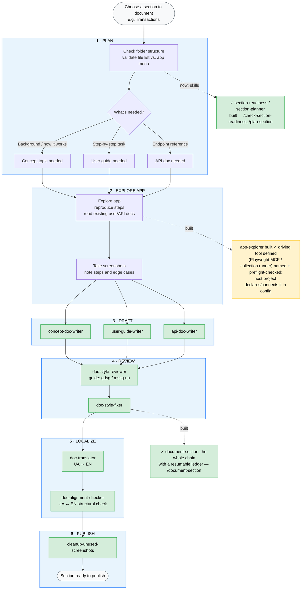

# TW Workflow Map

The documentation process stages mapped to the toolkit's skills. Use it to decide which skill to invoke next, and to spot the stages that are still manual.

---

---

## Skill quick reference

| Stage | Skill / Command | What it does |
|---|---|---|
| Readiness check | `section-readiness` | Classifies a section folder (skeleton / needs-revision / greenfield), emits a JSON verdict |
| Explore app | `app-explorer` | Explores the live app + API-seeded state, writes `.sources/app-notes.md` |
| Plan section | `section-planner` | Proposes IA (keep/merge/split/add) for a section, gated on approval |
| Whole section | `document-section` | Chains readiness → explore → plan → write → resolve markers → fix → review → UA approval → translate → align for one section, with a resumable ledger; stops at the approval gates |
| Draft — concept | `concept-doc-writer` | Background topics: how a feature works, what a term means |
| Draft — user guide | `user-guide-writer` | Task-based procedural docs for the product's UI |
| Draft — API | `api-doc-writer` | One endpoint per page, API reference format |
| Update a page | `doc-page-updater` | Applies a change brief to an approved page with the smallest edit; writes update-report.md for the scoped review / sync translation that follow |
| Resolve markers | `resolve-markers` | Batch-answers `{/* NEEDS CONFIRMATION */}` markers from evidence |
| Review style | `doc-style-reviewer` | Read-only findings report (gdsg / mssg-en / mssg-ua / ua-grammar) |
| Fix style | `doc-style-fixer` | Applies the reviewer's findings to the file |
| Translate | `doc-translator` | UA → EN, preserves MDX, enforces EN glossary |
| Translate — further locales | `locale-translator` | UA → every other locale of the site (not EN), only changed blocks, UI labels from the app's own dictionaries, scripted checks |
| Alignment check | `doc-alignment-checker` | Checks UA and EN pages are structurally in sync |
| Clean screenshots | `cleanup-unused-screenshots` | Moves unreferenced screenshots to `_unused/` |
| Icon-only controls | `identify-ui-icon` | Finds the Iconify id, SVG or screenshot crop for a control with no text; the writers call it by name |
| Screenshots from a recording | `extract-sme-screenshots` | Pulls deduplicated screenshots (and, if needed, a transcript) from an SME recording in `.sources/` |
| SME notes | `convert-sme-input` | Turns a transcript or raw notes into a structured `.sources/sme-interview.md` |

The full per-page pipeline from an SME video to a style-reviewed draft (`/doc-from-interview`) and the link-TODO repair (`/fix-doc-todos`) are commands, listed below. See [`SKILLS-INDEX.md`](plugins/doc-writer-toolkit/SKILLS-INDEX.md) for the canonical list with invocation examples.

## Commands quick reference

| Command | Underlying skill |
|---|---|
| `/doc-from-interview` | `extract-sme-screenshots` → `convert-sme-input` → the writer chosen by `type:` (`concept-doc-writer`, `user-guide-writer` or `api-doc-writer`) → `doc-style-reviewer` → `doc-style-fixer` |
| `/create-api-doc` | `api-doc-writer` |
| `/check-section-readiness` | `section-readiness` |
| `/plan-section` | `section-planner` |
| `/document-section` | `document-section`: `section-readiness` → `app-explorer` → `section-planner` → the writer by `docType` → `resolve-markers` → `doc-style-fixer` → `doc-style-reviewer` → `doc-translator` → `doc-alignment-checker` |
| `/explore-and-resolve` | `app-explorer` → `resolve-markers` |
| `/review-doc-style` | `doc-style-reviewer` |
| `/fix-doc-style` | `doc-style-fixer` |
| `/fix-doc-todos` | its own steps resolve link-type `{/* ToDo */}` markers, then `doc-alignment-checker` |
| `/translate-doc` | `doc-translator` |
| `/check-doc-alignment` | `doc-alignment-checker` |
| `/translate-locales` | `locale-translator` |
| `/update-doc-page` | `doc-page-updater` |
| `/identify-icon` | `identify-ui-icon` |

## Gaps (setup requirements)

| Gap | Why it matters | What it needs |
|---|---|---|
| Live-app driving tool | `app-explorer` names its driving tool (Playwright MCP / collection runner) and preflight-checks it; what remains is wiring the actual MCP server + runner into the host project and declaring them in its config | Playwright MCP server + collection runner connected in the session and declared in the host project's "Documentation toolkit configuration" |
